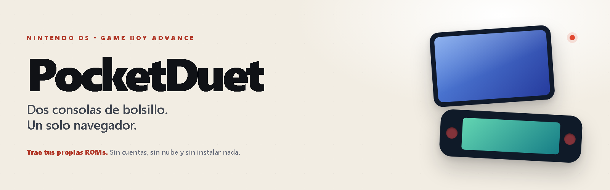
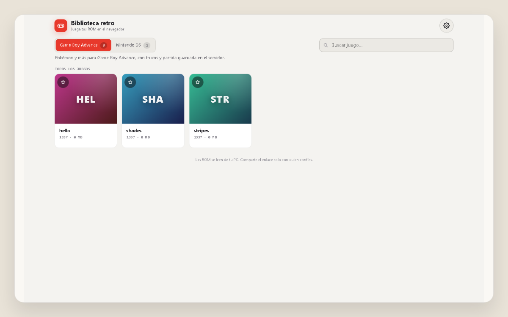
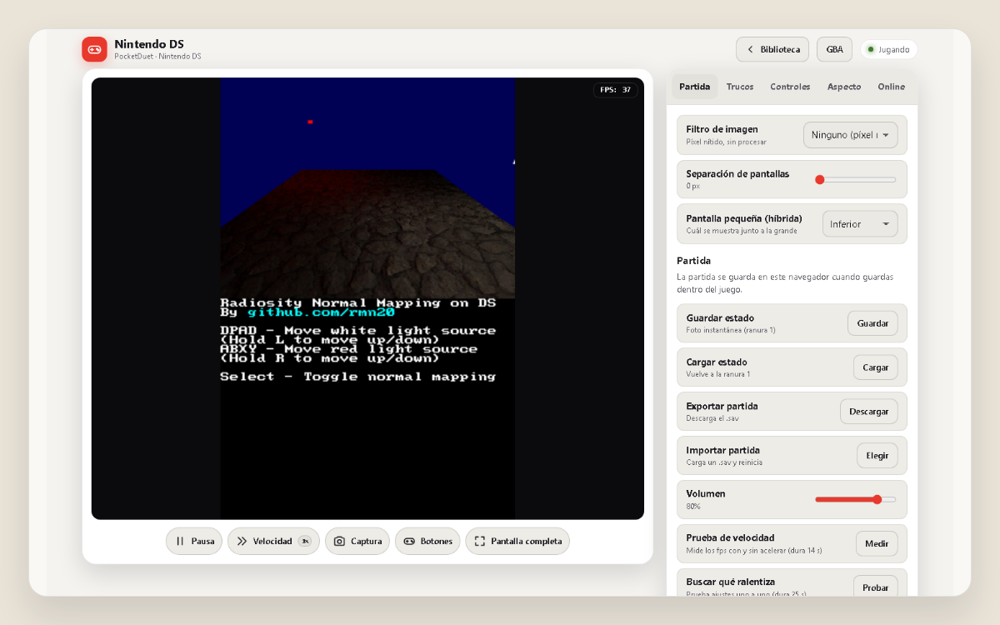
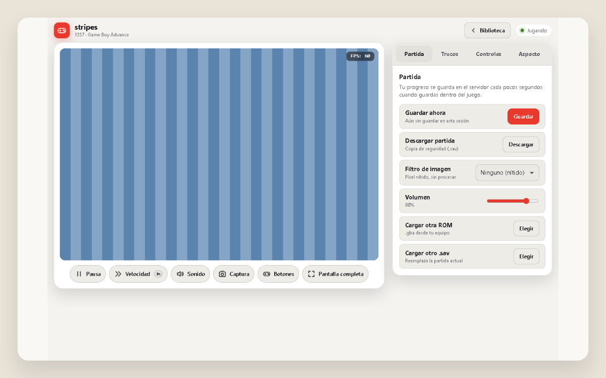
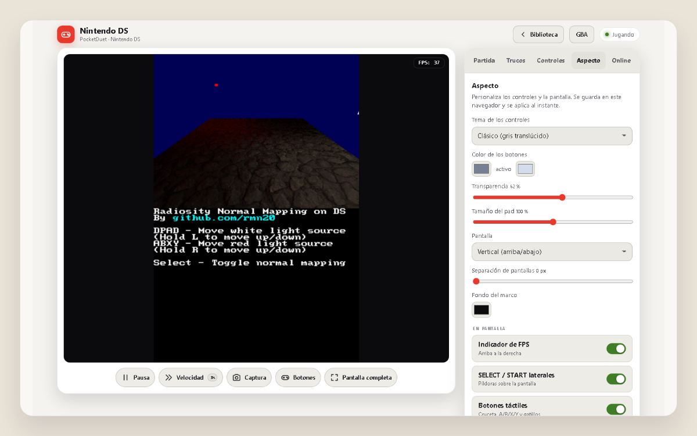
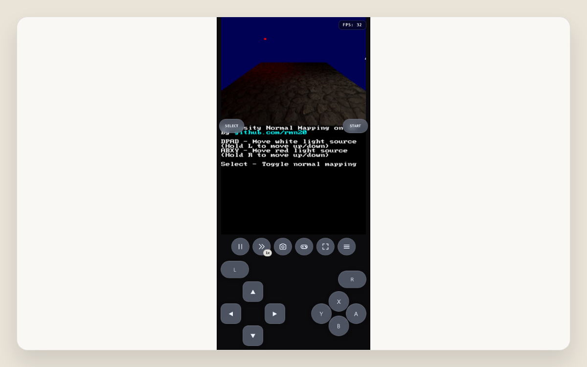
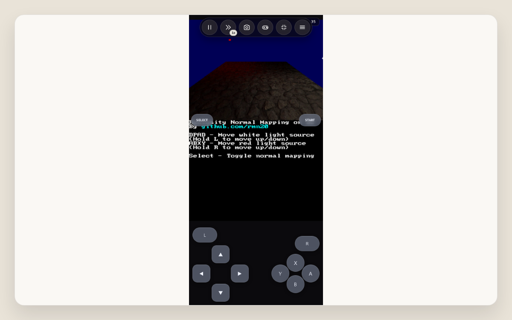
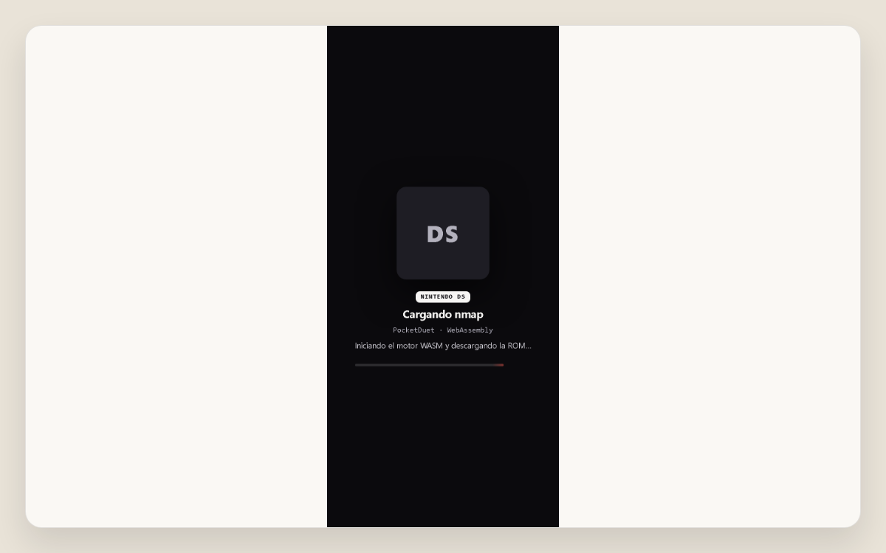
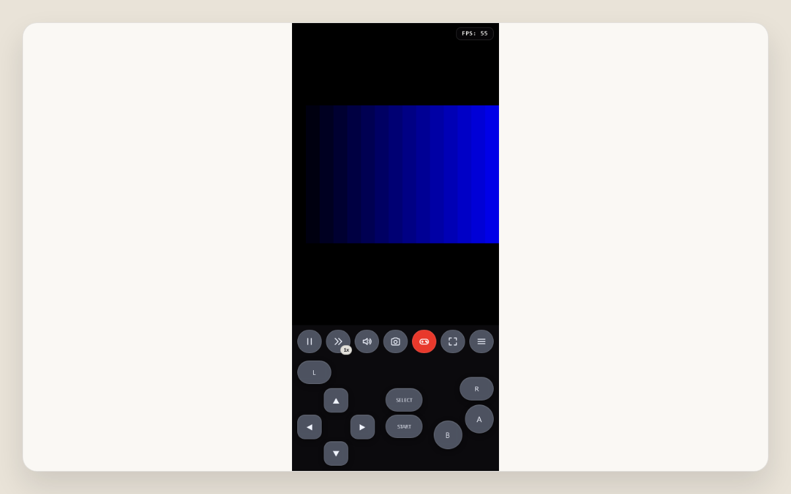

<p align="center">
  
</p>

# PocketDuet

<p align="center">
  <b>Español</b> · <a href="README.md">Read in English</a>
</p>

PocketDuet es una aplicación web para jugar **Nintendo DS** y **Game Boy Advance** en el navegador. Incluye una biblioteca, dos reproductores y un servidor Node que sirve tus propias ROMs. No contiene juegos, BIOS ni firmware.

<p align="center">
  <a href="LICENSE"></a>
  
  
  
  
</p>

---

## Qué incluye

- **Biblioteca.** Lee las ROM de `roms/nds` y `roms/gba`, muestra portadas cuando puede y abre cada juego en su reproductor.
- **Nintendo DS.** Usa el port de melonDS DS v1.4.0 a WebAssembly que desarrollé para la web, con pantalla doble, varios layouts, filtros, guardado, estados y trucos.
- **Game Boy Advance.** Usa mGBA compilado a WebAssembly, con guardado, estados, trucos y avance rápido.
- **Interfaz adaptada a móvil.** Controles táctiles, orientación vertical y horizontal, pantalla completa y opciones de tamaño, transparencia y tema del pad.
- **Uso local.** Las ROM se leen de tu equipo. Si publicas la aplicación en Internet, puedes protegerla con `ACCESS_KEY`.

## Capturas

<p align="center">
  
  
  <br>
  <sub>Biblioteca y reproductor de Nintendo DS.</sub>
</p>

<p align="center">
  
  
  <br>
  <sub>Game Boy Advance y ajustes de aspecto.</sub>
</p>

<p align="center">
  
  
  <br>
  <sub>Vista vertical y pantalla completa con controles táctiles.</sub>
</p>

<p align="center">
  
  
  <br>
  <sub>Carga del motor y Game Boy Advance en móvil.</sub>
</p>

<sub>Las capturas usan el homebrew CC0 <a href="https://github.com/rmn20/normalmappingds">nmap</a> y las ROM de prueba MIT de <a href="https://github.com/jsmolka/gba-tests">jsmolka/gba-tests</a>. No hay ROMs, BIOS ni carátulas comerciales en el repositorio.</sub>

## Empezar

Necesitas Node.js 22 o superior. El runtime de melonDS-WASM ya está incluido, así que no hay que compilar el port para jugar.

```bash
git clone --recurse-submodules https://github.com/soyangelromero/pocketduet.git
cd pocketduet
npm install
npm start
```

Abre `http://127.0.0.1:8080` y elige un juego en la biblioteca.

Para usar otras carpetas:

```bash
NDS_ROMS="D:/ROMS/NDS" GBA_ROMS="D:/ROMS/GBA" npm start
```

## ROMs y BIOS

```
roms/
  nds/    *.nds          # Nintendo DS
  gba/    *.gba          # Game Boy Advance
  bios/   biosnds7.rom   # opcional: BIOS y firmware reales de DS
          biosnds9.rom
          firmware.bin
```

Las carpetas `roms/` y `data/` están ignoradas por git. Las rutas se pueden cambiar con `NDS_ROMS`, `GBA_ROMS`, `NDS_BIOS` y `DATA_DIR`. Nintendo DS arranca sin BIOS (FreeBIOS y firmware generado); si añades tus propios dumps, los utiliza.

## El port de melonDS

El motor de Nintendo DS de esta aplicación es [melonDS-WASM](https://github.com/soyangelromero/melonds-wasm), un port a WebAssembly de melonDS DS v1.4.0 **hecho por mí**. En ese repositorio están el host C++, los parches, el build y la documentación del port. Aquí se usa el runtime ya compilado de `vendor/melonds/` y el submódulo `port-melonds/` conserva el código fuente GPL.

Game Boy Advance usa [mGBA](https://mgba.io/) mediante `@thenick775/mgba-wasm` (MPL-2.0).

La demo y el adaptador para integrar el port en otra web app están en `vendor/melonds/demo/` y `vendor/melonds/adapters/`.

## Despliegue

El servidor envía las cabeceras necesarias para `SharedArrayBuffer`:

```
Cross-Origin-Opener-Policy: same-origin
Cross-Origin-Embedder-Policy: require-corp
```

Para exponerlo fuera de la red local:

```bash
ACCESS_KEY="una-clave-larga-y-aleatoria" HOST=0.0.0.0 PORT=8080 npm start
```

Con `ACCESS_KEY`, la página, las APIs, los archivos estáticos y socket.io quedan protegidos. Hay ejemplos de Cloudflare Tunnel, Tailscale y VPS con Caddy o Nginx en [`deploy/README.md`](deploy/README.md).

## Preguntas frecuentes

### ¿Necesito BIOS o firmware?

No para jugar. Nintendo DS utiliza FreeBIOS y genera el firmware en el navegador; Game Boy Advance no necesita BIOS. Si tienes dumps legales, puedes colocarlos en `roms/bios/`.

### ¿Se suben mis ROMs a algún servidor?

No. La aplicación las lee de tu equipo y el servidor Node las entrega a tu propio navegador. Si publicas la aplicación en Internet, usa `ACCESS_KEY`.

### ¿Funciona en el móvil?

Sí. Incluye controles táctiles, SELECT/START laterales, pantalla completa, orientación vertical y horizontal y ajustes de tamaño y transparencia del pad.

### ¿Puedo jugar sin usar la biblioteca?

Sí. Abre `/nds/` y elige una ROM con el selector, o usa `/gba/?id=0` si ya está en `roms/gba/`.

### ¿Es legal?

Es un proyecto no oficial, sin relación con Nintendo, y no distribuye juegos ni BIOS. Utilízalo solo con copias que poseas legalmente.

## Licencias y créditos

- **PocketDuet:** GPL-3.0. Consulta [`LICENSE`](LICENSE).
- **melonDS-WASM / melonDS DS / melonDS:** GPL-3.0. Port hecho por mí, basado en [melonDS DS](https://github.com/JesseTG/melonDS-ds) y [melonDS](https://melonds.kuribo64.net/).
- **mGBA:** MPL-2.0, mediante [`@thenick775/mgba-wasm`](https://github.com/thenick775/mgba-wasm).
- **socket.io:** MIT.
- El detalle completo está en [`THIRD_PARTY.md`](THIRD_PARTY.md).

Proyecto no oficial. Nintendo DS y Game Boy Advance son marcas de Nintendo; este proyecto no está afiliado ni patrocinado por Nintendo. El port se desarrolló con ayuda de IA (Claude y DeepSeek) bajo dirección y pruebas humanas.
