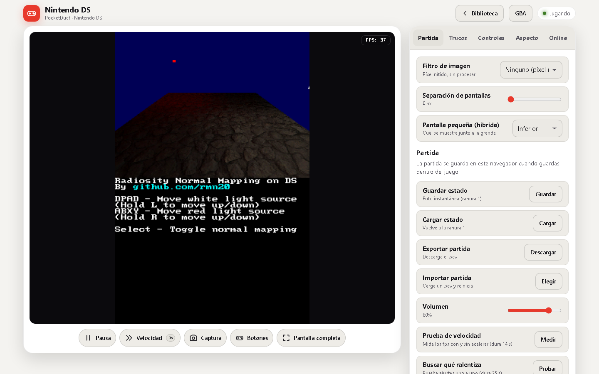
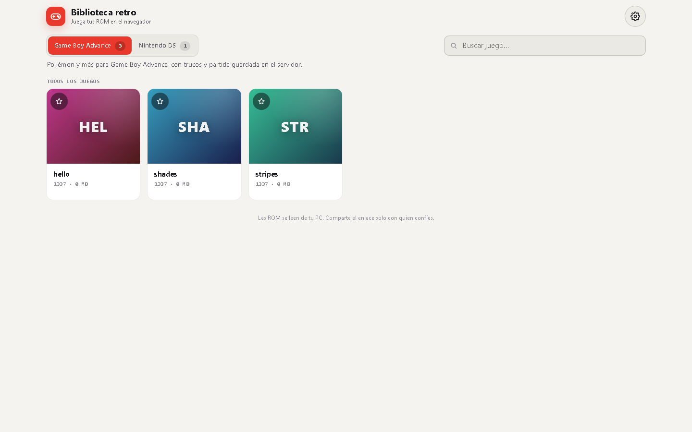
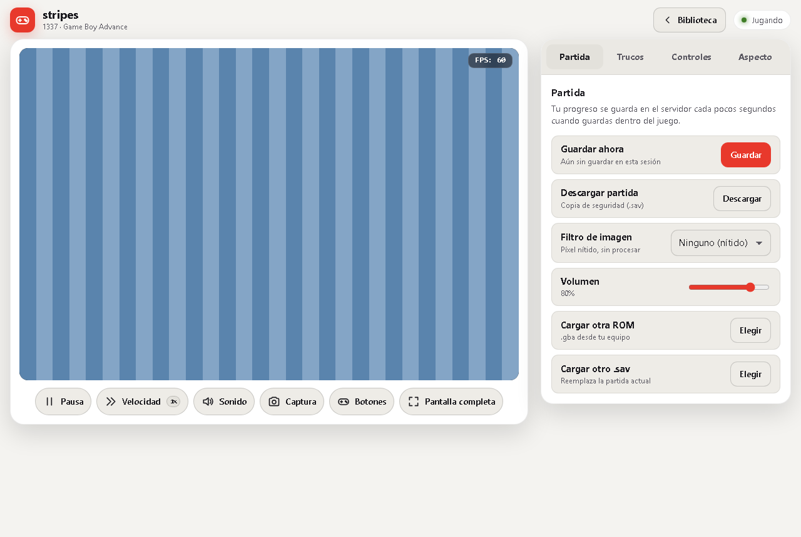
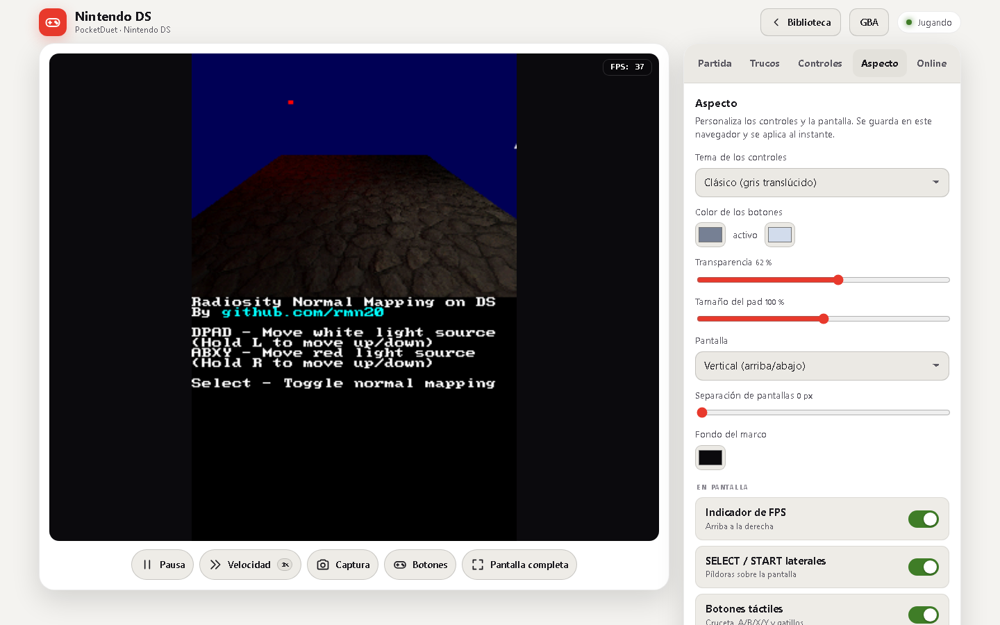
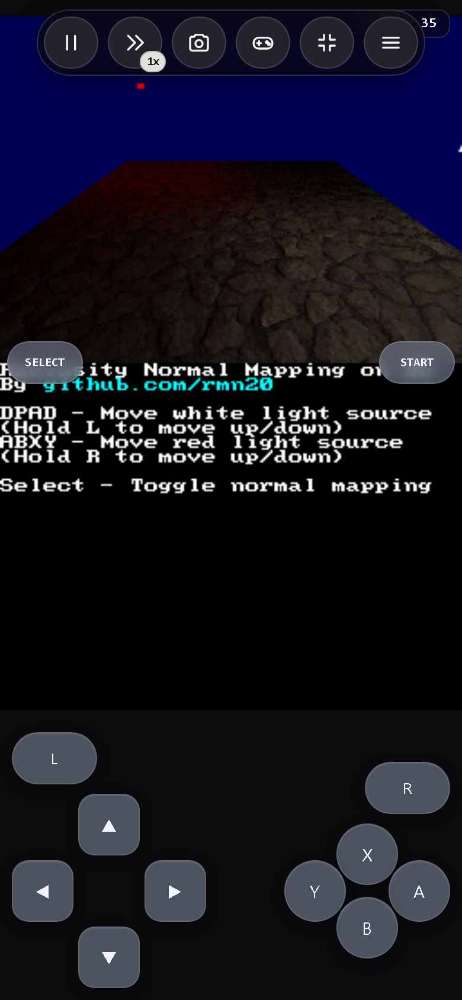
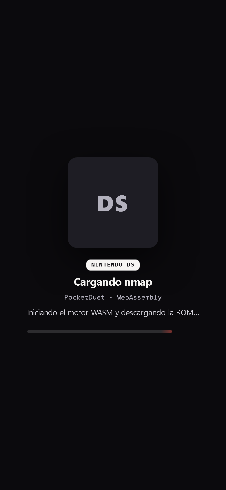
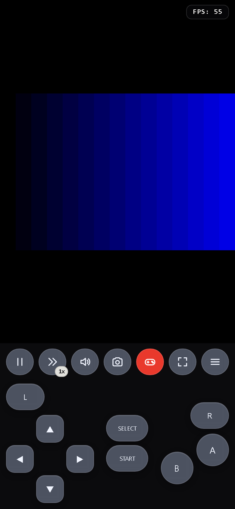

<p align="center">
  
</p>

<h1 align="center">PocketDuet</h1>

<p align="center">
  <b>Dos consolas. Una biblioteca. Sin instalar nada en el navegador.</b><br>
  Nintendo DS y Game Boy Advance, corriendo <b>en tu navegador</b>.
</p>

<p align="center">
  <a href="LICENSE"></a>
  
  
  
  
</p>

<p align="center">
  <a href="#-dos-consolas-una-biblioteca">Consolas</a> ·
  <a href="#-galería">Galería</a> ·
  <a href="#-en-30-segundos">Empezar</a> ·
  <a href="#-tus-roms-tus-reglas">ROMs</a> ·
  <a href="#-el-port-es-mío">El port</a> ·
  <a href="#-preguntas-frecuentes">FAQ</a>
</p>

---

<p align="center">
  
</p>

PocketDuet es una **web app completa** para jugar tus propios juegos de handheld: elige la consola, elige el juego y dale a jugar. Sin cuentas, sin nube y sin subir tus ROMs a ningún servidor.

> **Bring your own games.** No incluye juegos, BIOS ni firmware. Solo funciona con copias que tú aportes.

## 🎮 Dos consolas, una biblioteca

| **Nintendo DS** | **Game Boy Advance** |
|---|---|
| Un port propio de **melonDS DS v1.4.0** a WebAssembly, con pantalla doble, layouts, filtros, guardado, estados y trucos. | El clásico **mGBA** compilado a WASM, con guardado, estados, trucos, fast-forward y controles táctiles. |
| Pantalla doble, modos híbridos y mandos táctiles. | Guardado por servidor, estados y trucos. |

Una sola interfaz, dos motores. La biblioteca detecta tus ROM, descarga la carátula cuando puede y te lleva directo al reproductor.

## 🖼️ Galería

<p align="center">
  
  
  <br>
  <sub><b>La biblioteca</b> · <b>Game Boy Advance</b> con guardado y trucos.</sub>
</p>

<p align="center">
  
  <br>
  <sub><b>A tu manera.</b> Tema del pad, transparencia, tamaño, layouts y FPS.</sub>
</p>

<p align="center">
  
  
  
  
  <br>
  <sub><b>Vertical</b> · <b>Pantalla completa</b> · <b>Carga</b> · <b>GBA en el bolsillo.</b></sub>
</p>

<sub>Capturas con el homebrew CC0 <a href="https://github.com/rmn20/normalmappingds">nmap</a> y las test ROMs MIT de <a href="https://github.com/jsmolka/gba-tests">jsmolka/gba-tests</a>. El repositorio no contiene ninguna ROM ni carátula comercial; las imágenes son solo de la interfaz.</sub>

## ⚡ En 30 segundos

```bash
git clone --recurse-submodules https://github.com/soyangelromero/pocketduet.git
cd pocketduet
npm install
npm start
```

Abre **http://127.0.0.1:8080**, entra en la biblioteca y elige un juego. El runtime de melonDS-WASM ya viene prebuilt: **no necesitas compilar el port** para jugar.

¿Prefieres Docker? También hay servicio systemd, Caddy/Nginx y Cloudflare Tunnel en [`deploy/README.md`](deploy/README.md).

## 📁 Tus ROMs, tus reglas

```
roms/
  nds/    *.nds          # Nintendo DS
  gba/    *.gba          # Game Boy Advance
  bios/   biosnds7.rom   # opcional: BIOS/firmware reales de DS
          biosnds9.rom
          firmware.bin
```

- Las carpetas `roms/` y `data/` están **ignoradas por git**.
- Puedes cambiar las rutas con `NDS_ROMS`, `GBA_ROMS`, `NDS_BIOS` o `DATA_DIR`.
- La página de DS también acepta una ROM suelta con el selector o arrastrándola, sin pasar por la biblioteca.
- NDS arranca sin BIOS (FreeBIOS + firmware generado); si aportas tus dumps, los usa.

## 🧩 El port es mío

El motor de Nintendo DS de esta web app no es un emulador genérico: es **[melonDS-WASM](https://github.com/soyangelromero/melonds-wasm)**, un port a WebAssembly de melonDS DS v1.4.0 **hecho por mí**, con su propio host C++, adaptador para la web, worker y API. El código fuente, los parches y el build están en ese repositorio; aquí se consume el runtime prebuilt en `vendor/melonds/` y el submódulo `port-melonds/` mantiene la fuente GPL correspondiente.

El lado de Game Boy Advance usa **mGBA-WASM** (`@thenick775/mgba-wasm`, MPL-2.0).

Si quieres integrar el port en **tu propia** web app, el adaptador y la demo están en `vendor/melonds/adapters/` y `vendor/melonds/demo/`.

## 🙋 Preguntas frecuentes

<details>
<summary><b>¿Necesito BIOS o firmware?</b></summary>
No para jugar. NDS usa FreeBIOS y genera el firmware en el navegador; GBA no necesita BIOS. Si tienes dumps legales, puedes colocarlos en <code>roms/bios/</code>.
</details>

<details>
<summary><b>¿Sube mis ROMs a algún sitio?</b></summary>
No. La web app las lee de tu equipo; el servidor Node solo las sirve a tu propio navegador. Si lo publicas en Internet, protégete con <code>ACCESS_KEY</code>.
</details>

<details>
<summary><b>¿Funciona en el móvil?</b></summary>
Sí: controles táctiles, SELECT/START laterales, pantalla completa, orientación vertical/horizontal y ajustes de tamaño/transparencia del pad.
</details>

<details>
<summary><b>¿Puedo usarlo sin la biblioteca?</b></summary>
Sí. Abre <code>/nds/</code> y elige una ROM con el selector, o usa <code>/gba/?id=0</code> si ya está en <code>roms/gba/</code>.
</details>

<details>
<summary><b>¿Es legal?</b></summary>
Es un proyecto no oficial, sin relación con Nintendo, y no distribuye juegos ni BIOS. Úsalo solo con copias que poseas legalmente.
</details>

## 🚀 Despliegue

El servidor ya manda las cabeceras necesarias para `SharedArrayBuffer`:

```
Cross-Origin-Opener-Policy: same-origin
Cross-Origin-Embedder-Policy: require-corp
```

Para exponerlo fuera de tu red:

```bash
ACCESS_KEY="una-clave-larga-y-aleatoria" HOST=0.0.0.0 PORT=8080 npm start
```

Con `ACCESS_KEY`, la página, las APIs, los estáticos y socket.io quedan protegidos. Instrucciones para Cloudflare Tunnel, Tailscale y VPS en [`deploy/README.md`](deploy/README.md).

## 📜 Licencias y créditos

- **PocketDuet:** GPL-3.0 — ver [`LICENSE`](LICENSE).
- **melonDS-WASM / melonDS DS / melonDS:** GPL-3.0, port hecho por mí, basado en
  [melonDS DS](https://github.com/JesseTG/melonDS-ds) y [melonDS](https://melonds.kuribo64.net/).
- **mGBA:** MPL-2.0, vía [`@thenick775/mgba-wasm`](https://github.com/thenick775/mgba-wasm).
- **socket.io:** MIT.
- Detalle completo en [`THIRD_PARTY.md`](THIRD_PARTY.md).

<sub>Proyecto no oficial. Nintendo DS y Game Boy Advance son marcas de Nintendo; este proyecto no está afiliado ni patrocinado por Nintendo. Desarrollado con ayuda de IA (Claude y DeepSeek) bajo dirección y pruebas humanas.</sub>

---

<p align="center">
  <b>¿Te gusta la idea? Dale una ⭐ y compártela con alguien que todavía guarde sus cartuchos.</b>
</p>
