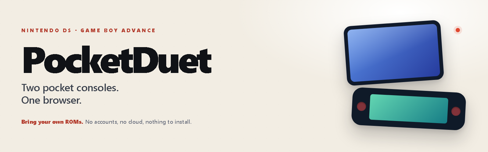
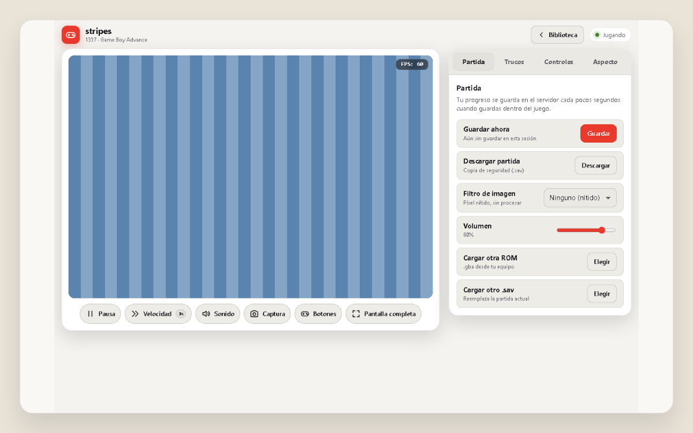
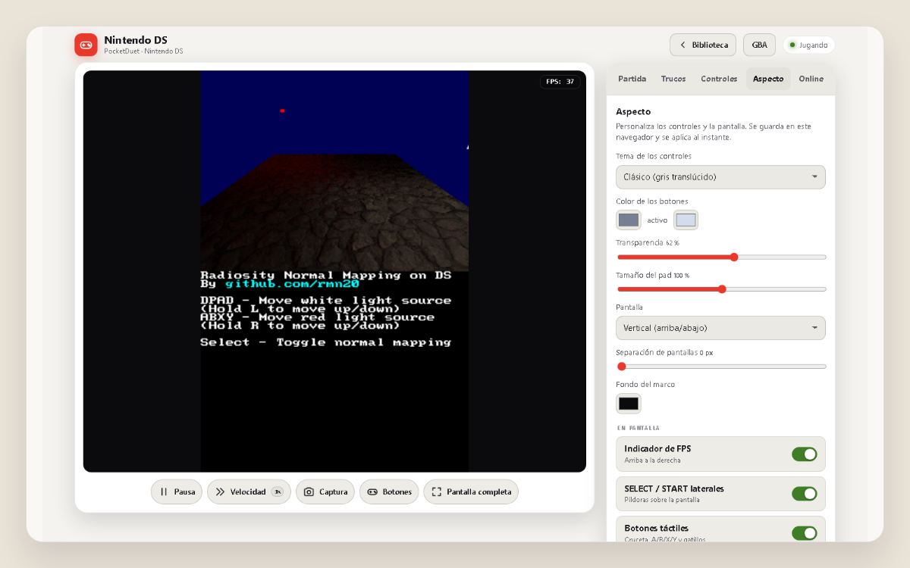
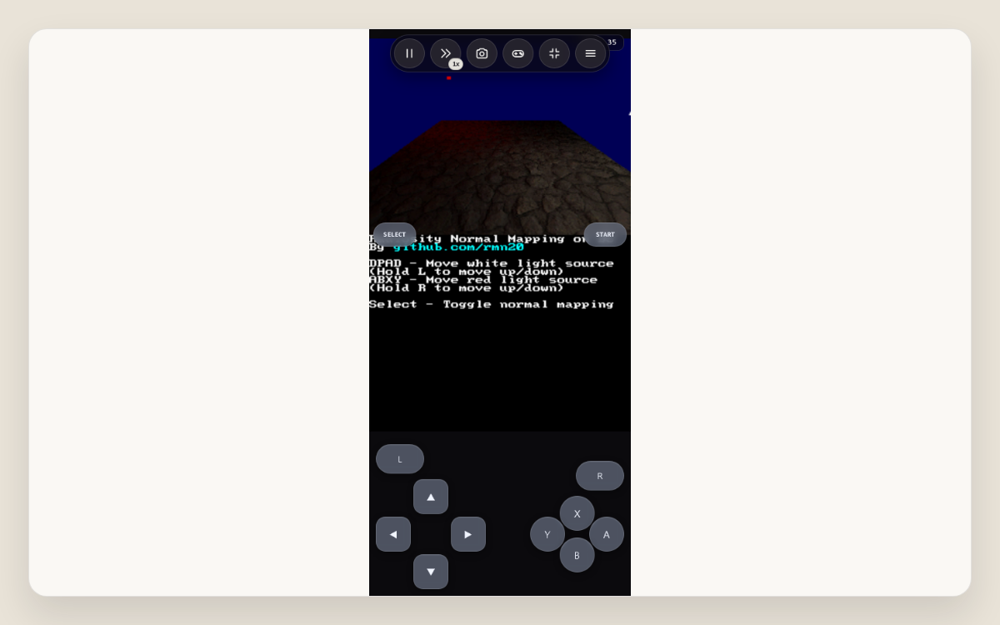
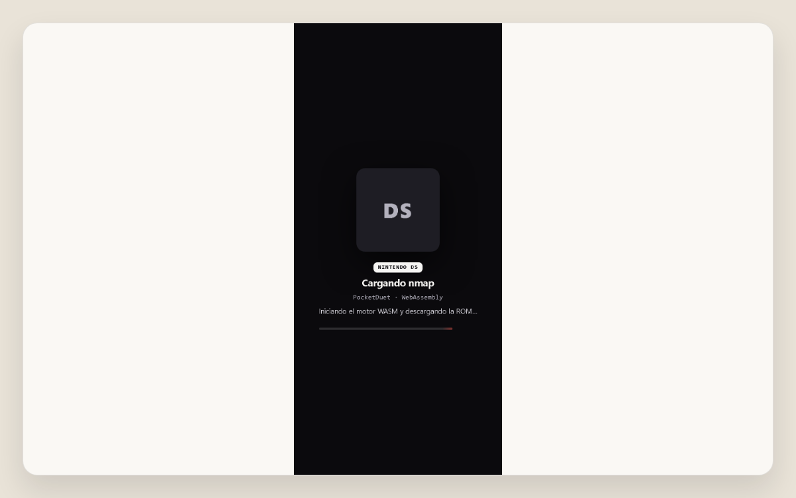
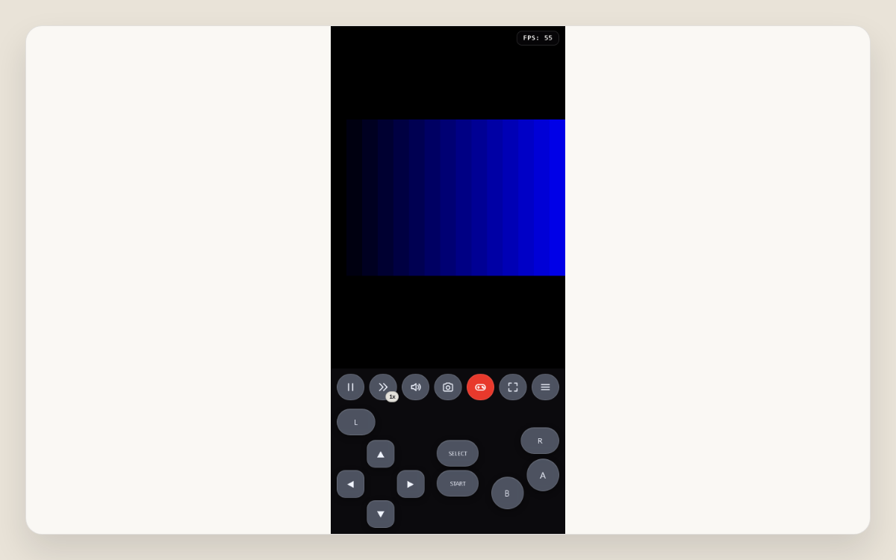

<p align="center">
  
</p>

# PocketDuet

<p align="center">
  <b>English</b> · <a href="README.es.md">Leer en español</a>
</p>

PocketDuet is a web app for playing **Nintendo DS** and **Game Boy Advance** games in the browser. It includes a library, two players and a Node server that serves your own ROMs. It does not contain games, BIOS files or firmware.

The public demo runs on Cloudflare Workers: **[Try PocketDuet](https://pocketduet-demo.soyangelromero.workers.dev)**. It does not include any ROMs; load your own from the player.

<p align="center">
  <a href="LICENSE"></a>
  
  
  
  
</p>

---

## What's included

- **Library.** Reads ROMs from `roms/nds` and `roms/gba`, shows cover art when available and opens each game in its player.
- **Nintendo DS.** Uses the WebAssembly port of melonDS DS v1.4.0 that I built for the web, with dual screens, multiple layouts, filters, saves, save states and cheats.
- **Game Boy Advance.** Uses mGBA compiled to WebAssembly, with saves, save states, cheats and fast-forward.
- **Mobile interface.** Touch controls, portrait and landscape layouts, fullscreen, and adjustable pad theme, size and transparency.
- **Local use.** ROMs are read from your machine. If you expose the app on the internet, protect it with `ACCESS_KEY`.

## Screenshots

<p align="center">
  
  
  <br>
  <sub>Library and Nintendo DS player.</sub>
</p>

<p align="center">
  
  
  <br>
  <sub>Game Boy Advance and display settings.</sub>
</p>

<p align="center">
  
  
  <br>
  <sub>Portrait mode and fullscreen with touch controls.</sub>
</p>

<p align="center">
  
  
  <br>
  <sub>Engine loading and Game Boy Advance on mobile.</sub>
</p>

<sub>Screenshots use the CC0 homebrew <a href="https://github.com/rmn20/normalmappingds">nmap</a> and the MIT test ROMs from <a href="https://github.com/jsmolka/gba-tests">jsmolka/gba-tests</a>. The repository contains no ROMs, BIOS files or commercial cover art.</sub>

## Getting started

You need Node.js 22 or newer. The melonDS-WASM runtime is already included, so you do not need to build the port to play.

```bash
git clone --recurse-submodules https://github.com/soyangelromero/pocketduet.git
cd pocketduet
npm install
npm start
```

Open `http://127.0.0.1:8080` and pick a game from the library.

To use different folders:

```bash
NDS_ROMS="D:/ROMS/NDS" GBA_ROMS="D:/ROMS/GBA" npm start
```

## ROMs and BIOS

```
roms/
  nds/    *.nds          # Nintendo DS
  gba/    *.gba          # Game Boy Advance
  bios/   biosnds7.rom   # optional: real DS BIOS and firmware
          biosnds9.rom
          firmware.bin
```

The `roms/` and `data/` folders are ignored by git. You can change the paths with `NDS_ROMS`, `GBA_ROMS`, `NDS_BIOS` and `DATA_DIR`. Nintendo DS boots without a BIOS (FreeBIOS and generated firmware); if you add your own dumps, it uses them.

## The melonDS port

The Nintendo DS core in this app is [melonDS-WASM](https://github.com/soyangelromero/melonds-wasm), a WebAssembly port of melonDS DS v1.4.0 **made by me**. That repository contains the C++ host, patches, build scripts and port documentation. This app uses the prebuilt runtime in `vendor/melonds/`, and the `port-melonds/` submodule keeps the corresponding GPL source.

Game Boy Advance uses [mGBA](https://mgba.io/) through `@thenick775/mgba-wasm` (MPL-2.0).

The demo and adapter for integrating the port into another web app are in `vendor/melonds/demo/` and `vendor/melonds/adapters/`.

## Deployment

The server sends the headers required for `SharedArrayBuffer`:

```
Cross-Origin-Opener-Policy: same-origin
Cross-Origin-Embedder-Policy: require-corp
```

To expose it outside your local network:

```bash
ACCESS_KEY="a-long-random-key" HOST=0.0.0.0 PORT=8080 npm start
```

With `ACCESS_KEY`, the page, APIs, static files and socket.io are protected. Examples for Cloudflare Tunnel, Tailscale and a VPS with Caddy or Nginx are in [`deploy/README.md`](deploy/README.md) (Spanish).

## FAQ

### Do I need a BIOS or firmware?

No, not to play. Nintendo DS uses FreeBIOS and generates firmware in the browser; Game Boy Advance does not need a BIOS. If you have legal dumps, you can place them in `roms/bios/`.

### Are my ROMs uploaded anywhere?

No. The app reads them from your machine and the Node server serves them to your own browser. If you publish the app on the internet, use `ACCESS_KEY`.

### Does it work on mobile?

Yes. It includes touch controls, side SELECT/START buttons, fullscreen, portrait and landscape layouts, and adjustable pad size and transparency.

### Can I play without using the library?

Yes. Open `/nds/` and choose a ROM with the file picker, or use `/gba/?id=0` if the ROM is already in `roms/gba/`.

### Is this legal?

This is an unofficial project, not affiliated with Nintendo, and it does not distribute games or BIOS files. Use it only with copies you legally own.

## Licenses and credits

- **PocketDuet:** GPL-3.0. See [`LICENSE`](LICENSE).
- **melonDS-WASM / melonDS DS / melonDS:** GPL-3.0. Port made by me, based on [melonDS DS](https://github.com/JesseTG/melonDS-ds) and [melonDS](https://melonds.kuribo64.net/).
- **mGBA:** MPL-2.0, through [`@thenick775/mgba-wasm`](https://github.com/thenick775/mgba-wasm).
- **socket.io:** MIT.
- Full details are in [`THIRD_PARTY.md`](THIRD_PARTY.md).

This is an unofficial project. Nintendo DS and Game Boy Advance are trademarks of Nintendo; this project is not affiliated with or endorsed by Nintendo. The port was developed with AI assistance (Claude and DeepSeek) under human direction and testing.
