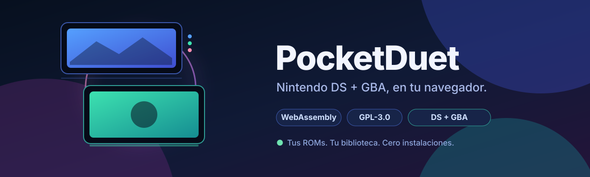
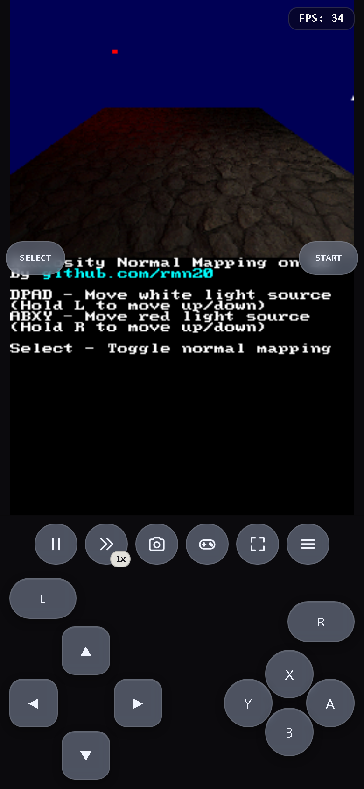

<p align="center">
  
</p>

<h1 align="center">Emerald Web</h1>

<p align="center">
  <b>Nintendo DS y Game Boy Advance, jugables directamente en tu navegador.</b><br>
  Un solo servidor Node, sin frameworks de front-end y sin subir tus ROMs a ningún sitio.
</p>

<p align="center">
  <a href="LICENSE"></a>
  
  
  
  
  
</p>

<p align="center">
  <a href="#inicio-rápido">Inicio rápido</a> ·
  <a href="#qué-incluye">Qué incluye</a> ·
  <a href="#roms-y-bios">ROMs y BIOS</a> ·
  <a href="#integración-del-port">Integración del port</a> ·
  <a href="#despliegue">Despliegue</a> ·
  <a href="#licencias">Licencias</a>
</p>

---

## Capturas

<p align="center">
  
</p>
<p align="center">
  
  
</p>

<p align="center">
  <sub>Capturas con el homebrew CC0 <a href="https://github.com/rmn20/normalmappingds"><i>nmap</i></a>.
  Este repositorio no contiene ninguna ROM, BIOS, firmware, partida ni carátula comercial.</sub>
</p>

## Qué incluye

**Emerald Web** es la aplicación web completa que integra los dos emuladores y la biblioteca:

| Pieza | Detalle |
|---|---|
| 🎮 **Nintendo DS** | Port **melonDS DS v1.4.0** a WebAssembly, adaptado a la interfaz web (`?engine=wasm`). Runtime en `vendor/melonds/`; fuente en el submódulo `port-melonds/`. |
| 🕹️ **Game Boy Advance** | Reproductor **mGBA-WASM** (`@thenick775/mgba-wasm` v2.6.0) con guardado, estados, trucos, controles táctiles y pantalla completa. |
| 🗂️ **Biblioteca** | Hub que lista tus propias ROMs de `roms/`, portadas descargadas en caché y acceso a ambos reproductores. |
| 👥 **Multijugador** | Señalización socket.io para el anfitrión WebRTC del port de DS. |
| 📱 **Móvil** | Interfaz táctil, disposiciones vertical/horizontal, pantalla completa con controles, temas de pad y ajustes de pantalla. |
| 🔐 **Acceso remoto** | `HOST`, `PORT` y `ACCESS_KEY` (página, APIs, estáticos y socket.io) listos para túnel o VPS. |

> **NO incluye juegos.** Este repositorio no contiene ninguna ROM, BIOS, firmware, save ni carátula. Solo funciona con
> copias que tú aportes; las carpetas `roms/` y `data/` están ignoradas por git. Tampoco se incluye ninguna cuenta,
> telemetría ni subida de archivos.

## Inicio rápido

Requisitos: **Node.js 22+** y tus propias ROMs (opcionales para arrancar: la biblioteca sale vacía).

```bash
git clone --recurse-submodules https://github.com/soyangelromero/emerald-web.git
cd emerald-web

npm install
npm start
# abre http://127.0.0.1:8080
```

El runtime prebuilt de melonDS-WASM ya está en `vendor/melonds/`, así que **no hace falta compilar el port** para
jugar. El submódulo `port-melonds/` es el código fuente GPL correspondiente y sirve para actualizarlo.

También puedes usar variables de entorno si tus ROMs están en otra carpeta:

```bash
NDS_ROMS="D:/ROMS/NDS" GBA_ROMS="D:/ROMS/GBA" NDS_BIOS="D:/ROMS/BIOS" npm start
```

## ROMs y BIOS

Coloca tus propios archivos en estas carpetas (están en `.gitignore`):

```
roms/
  nds/    *.nds          # Nintendo DS (las partidas .sav se guardan junto a la ROM)
  gba/    *.gba          # Game Boy Advance
  bios/   biosnds7.rom   # opcional: BIOS y firmware reales de DS
          biosnds9.rom
          firmware.bin
```

También puedes cambiar las rutas con `NDS_ROMS`, `GBA_ROMS`, `NDS_BIOS`, `GBA_SAVES`, `DATA_DIR` o
`MELONDS_ROOT`. La página de NDS también permite **cargar una ROM suelta** con el selector o arrastrándola, sin
tocarla en el servidor.

- **NDS:** el port arranca sin BIOS ni firmware reales (FreeBIOS + firmware generado); si aportas los dumps, se usan.
- **GBA:** mGBA detecta el tipo de guardado; las partidas se guardan en `data/gba-saves/`.
- **Sin ROMs:** el hub y los dos reproductores arrancan con la biblioteca vacía; las APIs devuelven `[]`.

## Integración del port

Dos niveles, para que el repo funcione recién clonado y siga siendo GPL:

1. **Runtime prebuilt en `vendor/melonds/`** (`dist/melonds.js`, `dist/melonds.wasm`, `js/`, `adapters/`, `demo/`).
   El servidor lo publica en `/nds/wasm/` y la página de NDS lo carga con `?engine=wasm`.
2. **Fuente en `port-melonds/`** (submódulo del repo
   [`melonds-wasm`](https://github.com/soyangelromero/melonds-wasm), GPL-3.0), con sus parches, scripts de build y
   documentación.

Actualizar el port:

```bash
git submodule update --remote port-melonds
cd port-melonds && ./scripts/build.sh && cd ..
npm run sync:port
```

`sync:port` copia los artefactos generados desde el submódulo a `vendor/melonds/`. Si prefieres no usar submódulos,
descarga el release del port y copia el runtime a `vendor/melonds/`; la licencia y la fuente siguen siendo las
del proyecto melonDS/melonDS DS.

La interfaz de NDS es independiente del emulador: sigue siendo la misma página, y el adaptador traduce sus llamadas
al motor WASM. Puedes reutilizar ese patrón para integrar el port en **tu propia** web app; la demo y el adaptador
están en `vendor/melonds/demo/` y `vendor/melonds/adapters/`.

## Despliegue

El servidor manda las cabeceras necesarias para `SharedArrayBuffer`:

```
Cross-Origin-Opener-Policy: same-origin
Cross-Origin-Embedder-Policy: require-corp
```

Si vas a exponerlo fuera de tu red, usa una clave:

```bash
ACCESS_KEY="una-clave-larga-y-aleatoria" HOST=0.0.0.0 PORT=8080 npm start
```

Sin clave, cualquiera que alcance el puerto ve tus ROMs. Con `ACCESS_KEY`, todas las rutas (incluido el handshake de
socket.io) exigen `?k=CLAVE` o la cookie que se crea al abrirla una vez.

Opciones completas (Cloudflare Tunnel con nombre, Tailscale o VPS con Caddy/Nginx y systemd) en
[`deploy/README.md`](deploy/README.md). Para hostings estáticos sin cabeceras, el port incluye `coi-sw.js` y
`?coi=1` como aislamiento de respaldo.

## Estructura

```
server.mjs           hub Node: estáticos, APIs, guardados y señalización socket.io
home/                biblioteca inicial
nds/                 reproductor Nintendo DS (interfaz y adaptador)
site/                reproductor Game Boy Advance (mGBA-WASM + trucos)
ui/                  CSS/JS compartido de la interfaz
vendor/melonds/      runtime prebuilt de melonDS-WASM
port-melonds/        submódulo: fuente y build del port (GPL-3.0)
roms/                tus ROMs (ignorado por git)
data/                partidas GBA y caché de carátulas (ignorado por git)
deploy/              configuraciones de túnel, Caddy/Nginx y systemd
docs/                arquitectura y documentación
tests/               smoke test del servidor
```

## Tests

```bash
npm test
```

Incluye un test de humo que arranca el servidor con bibliotecas vacías y comprueba que `/`, `/nds/`, `/gba/`,
`/ui/`, `/coi-sw.js`, el runtime del port en `/nds/wasm/` y las APIs responden, que la lista de ROMs está vacía y que
la lista blanca del port no expone `third_party/`. No necesita ROMs ni navegador.

## Licencias y créditos

- **Código de esta web app:** GPL-3.0 — ver [`LICENSE`](LICENSE).
- **melonDS DS / melonDS:** GPL-3.0; fuente en el submódulo
  [`port-melonds`](https://github.com/soyangelromero/melonds-wasm) y en
  <https://github.com/JesseTG/melonDS-ds> / <https://melonds.kuribo64.net/>.
- **mGBA:** MPL-2.0; binario en `site/mgba.wasm`, generado con
  [`@thenick775/mgba-wasm`](https://github.com/thenick775/mgba-wasm) v2.6.0. Fuente: <https://github.com/mgba-emu/mgba>.
- **socket.io:** MIT.
- Detalle completo en [`THIRD_PARTY.md`](THIRD_PARTY.md).

**Aviso legal:** proyecto no oficial, sin relación con Nintendo. No se distribuye ninguna ROM, BIOS, firmware ni
save. Úsalo solo con copias que poseas legalmente. El port se desarrolló con ayuda de IA (Claude y DeepSeek) bajo la
dirección y pruebas del autor; pruébalo con tus propios juegos.

---

<p align="center">
  <b>Si te resulta útil, dale una ⭐ al repositorio y prueba a integrar el port en tu propia web app.</b>
</p>
